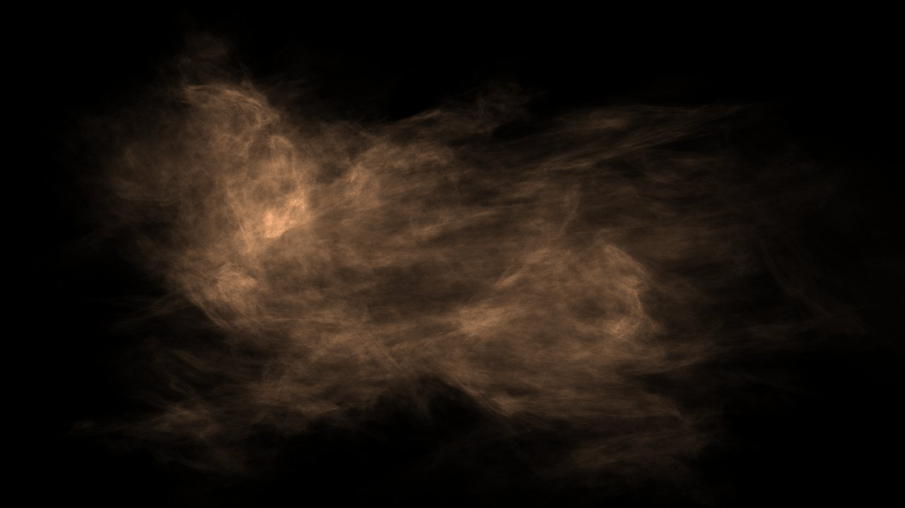
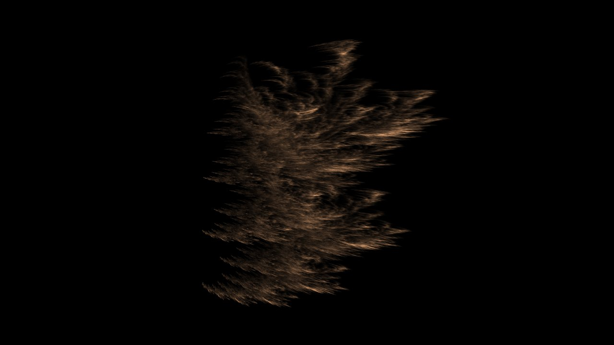
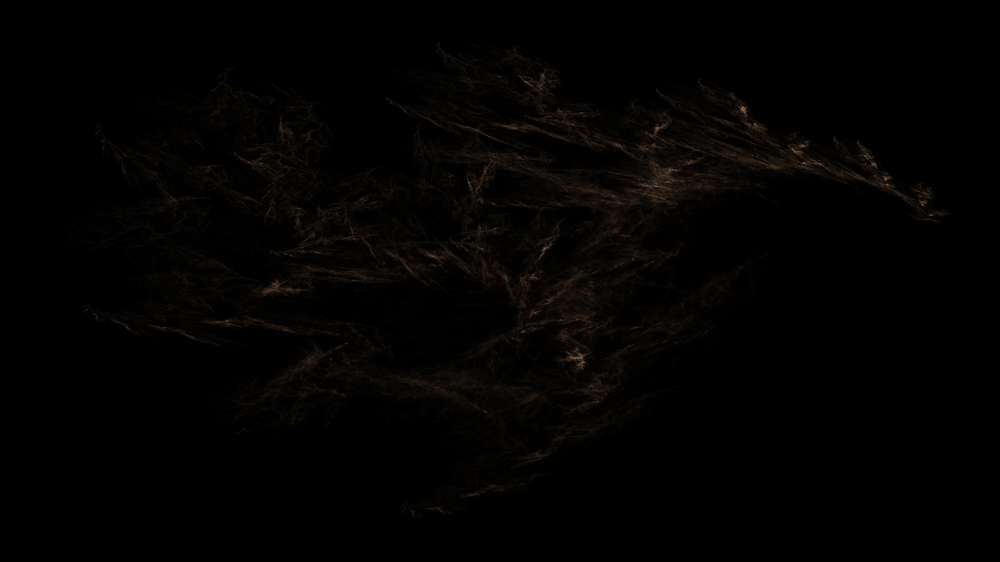
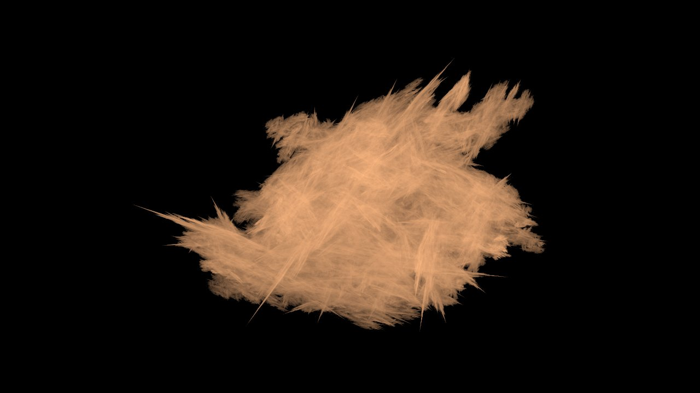
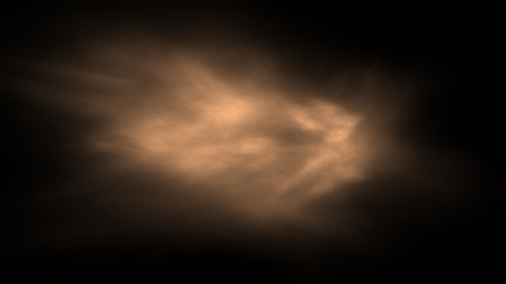

## Project Overview {#overview}

Animated 3D fractals made of particles (100,000 per frame, accumulated over many frames), rendered on the CPU in C++. I saw [Acerola](https://www.youtube.com/@Acerola_t) make something like this, thought it looked cool, and wrote my own version from scratch, focusing on making it fast.

## How It Works {#how}

The fractal is an **iterated function system**, drawn with the "chaos game":

1. Pick a few random 3D affine transforms (scale, rotation, shear, translation).
2. Start with a cloud of random points. Every step, move each point by one of the transforms, picked at random.
3. After a few iterations the points settle onto the fractal that those transforms define.

To animate it, the program smoothly interpolates each transform toward a new random target, then picks another target when it gets there. The fractal keeps morphing into new shapes.

## Rendering {#rendering}

I tried a few different renderers:

- **Point splatting:** Project every particle onto the screen and accumulate how many land on each pixel, then map that density to brightness. Accumulating over several frames smooths out the noise.
- **Ray marching:** Treat the fractal as a volume of density, march a ray through it for each pixel, and attenuate light as it passes through (Beer-Lambert absorption), so the fractal looks like glowing smoke instead of points.
- **Discrete ray marching:** First bin the particles into a 3D grid of densities, then ray march through the grid, which is much cheaper to sample.

Everything runs on the CPU, compiled with aggressive optimization flags (`-O3 -march=native -ffast-math`), with per-frame values precomputed outside the hot loops. There is also an offline mode that renders frames to disk to stitch into a video with ffmpeg.

## Gallery {#gallery}

<!-- TODO: add a rendered video of the fractal morphing -->

## What's Next {#next}

I've learned a lot more about CPU optimization since I wrote this (SIMD, cache-friendly memory layouts, multithreading), and I could make it much faster now. It would also be a good project for learning **Vulkan** to run it on my laptop's GPU, since OpenCL doesn't handle its unified memory well.

## Technology Stack {#tech-stack}
- C++
- GLM (vector math)
- SFML (window and display)
- ffmpeg (video export)
